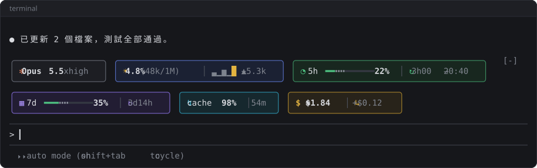

# claude-code-mods

TroyWhiteTW 的 Claude Code mods，為終端機（CLI）設計。

## Mods

### [usage-meter](mods/usage-meter)

在提示框上方顯示模型、context、5h／7d 額度、快取與花費。



## 安裝

在 Claude Code 的提示框輸入，`<mod>` 換成上面的 mod 名稱：

```
/plugin install <mod> --marketplace TroyWhiteTW/claude-code-mods
```

例如：

```
/plugin install usage-meter --marketplace TroyWhiteTW/claude-code-mods
```

## 更新

```
claude plugin update <mod>@troywhitetw-mods
```

接著在 Claude Code 輸入 `/reload-plugins`。
