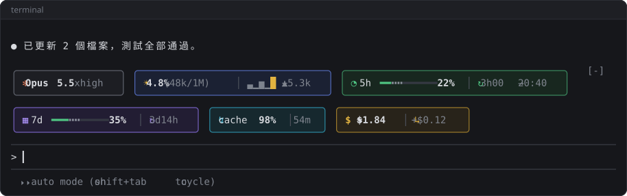
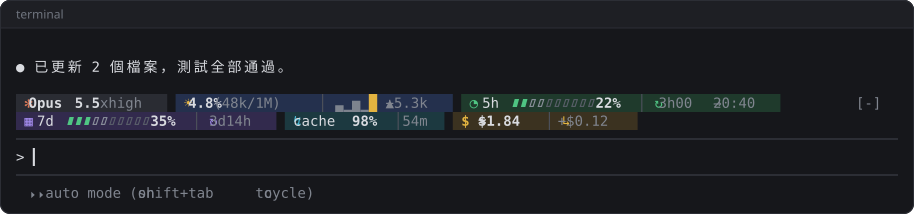
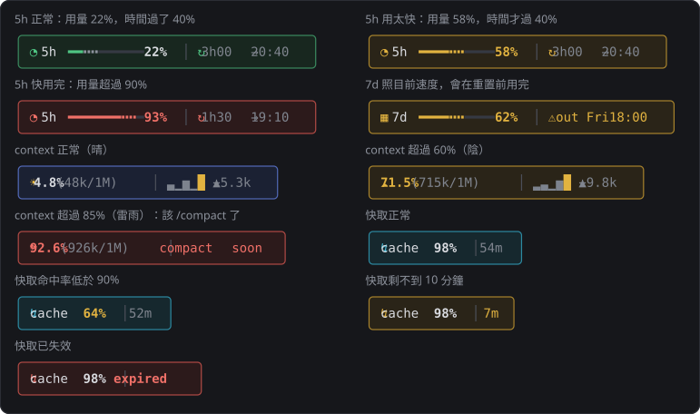

# usage-meter

在 Claude Code 提示框上方顯示一列用量資訊，為終端機（CLI）設計。



## 顯示內容

- 模型與思考強度（effort）
- context 用量：百分比、已用／上限，以及最近 5 則 prompt 各增加多少
  - 某則讓 context 變少時（例如 compact），那格畫成最低，不影響其他格的比例
  - 用到 85% 以上時，這段改成 `compact soon`，提醒該 compact 了
- 5 小時、7 天額度：已用量、跟時間進度的差距、重置時間（訂閱帳號才有）
  - 7 天額度照目前速度會在重置前用完時，重置時間改成 `⚠ out Fri 18:00`，也就是預估用完的時間
  - 過了重置時間先顯示 0%，下一則回應後更新成實際數字
- 快取命中率，以及快取還剩幾分鐘失效（以 1 小時倒數，每送一則重新計時）
- session 累計花費與最新一則的花費

終端機不夠寬時會自動換行；上圖是 105 欄寬的樣子，夠寬的話會排成一列。

## 安裝

在 Claude Code 的提示框輸入：

```
/plugin install usage-meter --marketplace TroyWhiteTW/claude-code-mods
```

或在終端機執行：

```
claude plugin install usage-meter --marketplace TroyWhiteTW/claude-code-mods
```

## 更新

```
claude plugin update usage-meter@troywhitetw-mods
```

接著在 Claude Code 輸入 `/reload-plugins`。

## 選項

輸入 `/config` 調整：

| 選項 | 可選值 | 預設 |
|---|---|---|
| 版面 | `A` 圓角框（占 3 列）、`B` 底色塊（占 1 列） | `A` |
| 進度條樣式 | `auto`、`line` 細線、`segment` 分格 | `auto`（A 用細線、B 用分格） |
| 顯示快取 | 開／關 | 開 |
| 顯示花費 | 開／關 | 開 |

版面 B：



## 顏色

- 綠：正常
- 黃：額度用得比時間快（5 小時額度過 30 分鐘、7 天額度過約 17 小時後才開始判斷）、context 用了 60% 以上、快取剩不到 10 分鐘、快取命中率低於 90%
- 紅：額度用了 90% 以上、context 用了 85% 以上、快取已失效

進度條的實線是已用量，虛線是已用量跟時間進度的差距：灰色代表還有餘裕，變成彩色代表用得比時間快。


